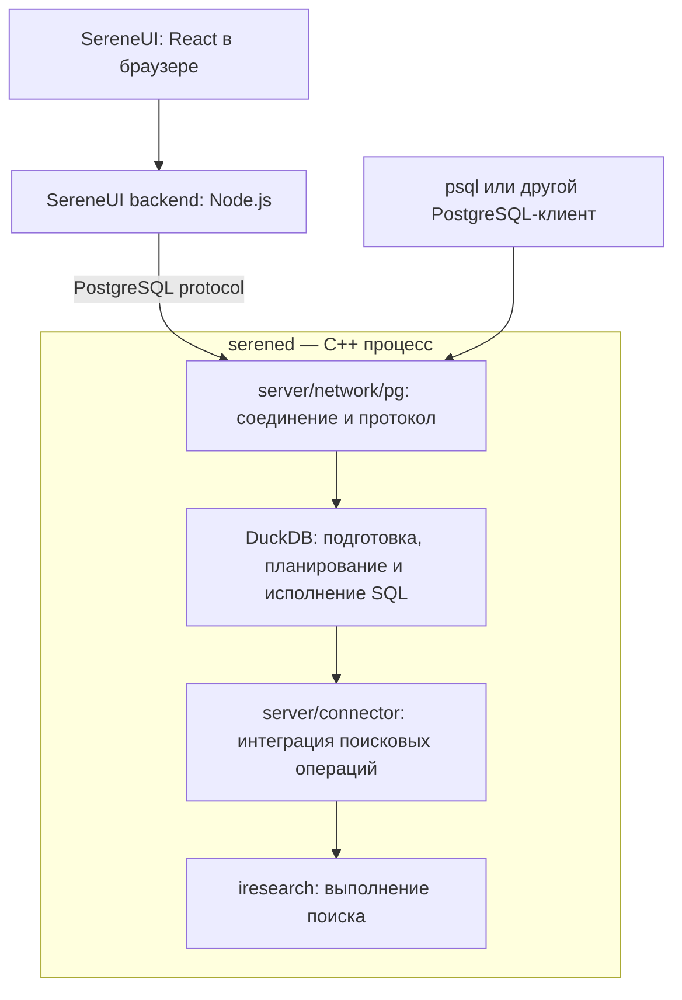

# Структура проекта SereneDB

В репозитории три основные части: **сервер базы данных на C++**, **поисковый движок IResearch** и **клиентский интерфейс SereneUI на TypeScript**. DuckDB встроен в C++-сервер и отвечает за значительную часть обработки SQL.

Общая структура:

```text
serenedb/
├── server/          Сервер: соединения, SQL-интеграция, каталог, репликация
├── iresearch/       Поисковые индексы, токенизация, поиск и ранжирование
├── third_party/     DuckDB, его расширения и остальные зависимости
├── serene-ui/       Веб-интерфейс, его backend и Electron-приложение
├── apps/            Дополнительные приложения, сейчас поиск по документации
├── tests/           C++-, SQL-, клиентские тесты и бенчмарки
├── examples/        Примеры использования
├── docs/            Пользовательская документация
├── scripts/         Разработка, CI, проверки и измерения производительности
├── cmake/           Вспомогательная логика сборки
├── packages/        Docker, Debian, Helm и tarball-пакеты
├── resources/       Ресурсы, лицензии, тестовые данные
├── etc/             Шаблоны конфигурации сервера
├── .github/         GitHub Actions и настройки CI
├── .claude/rules/   Правила разработки по темам
├── CMakeLists.txt   Корневая сборка C++
├── CMakePresets.json
├── build/           Результаты локальной сборки
└── build_data/      Данные твоего локального экземпляра БД
```

**Сначала полезно понять, как проходит запрос.** Для веб-интерфейса путь выглядит примерно так:



Это схема пути поискового SQL-запроса. Обычный запрос может исполняться средствами DuckDB без обращения к IResearch. У сервера также есть HTTP-обработчики.

**`server/` — код, который превращает движки в работающую серверную БД.**

Точка входа — [server/rest_server/serened.cpp](server/rest_server/serened.cpp). Здесь разбираются параметры запуска, инициализируется встроенный DuckDB, регистрируются расширения SereneDB и запускаются серверные компоненты.

Внутри `server/` обязанности распределены так:

| Каталог | За что отвечает |
|---|---|
| `network/` | Слушающие сокеты, соединения, TLS, сетевой ввод-вывод, отмена запросов |
| `network/pg/` | PostgreSQL wire protocol: startup, аутентификация, Parse/Bind/Execute, COPY, отправка результатов |
| `network/http/` | HTTP-протокол, маршрутизация, сжатие, обработчики Elasticsearch API, OTEL и MCP |
| `pg/` | Совместимость с PostgreSQL выше сетевого уровня: типы, системные каталоги, сериализация значений, состояние соединения |
| `query/` | Настройка SQL-движка для серверного режима, регистрация функций и расширений, настройки запросов и транзакций |
| `connector/` | Интеграция DuckDB с поисковыми таблицами и индексами SereneDB |
| `catalog/` | Метаданные баз, поисковых таблиц, индексов, токенизаторов, ролей, подписок и заданий |
| `search/` | Жизненный цикл поискового хранилища: изменения, транзакции, checkpoint, восстановление и обслуживание |
| `storage_engine/` | Компонент `SearchEngine`, запускающий и останавливающий обслуживание поисковых хранилищ |
| `auth/` | Проверка прав и работа с отношениями между ролями |
| `replication/` | Подписки, подключения к источнику, протокол логической репликации и обработка `pgoutput` |
| `scheduler/` | Фоновые задачи и задания по расписанию |
| `otel/` | Разбор и преобразование OpenTelemetry-данных |
| `docs/` | Встроенный индекс документации, SQL-функции поиска по нему и интеграция с shell |
| `rest_server/` | Запуск процесса и управление временем жизни серверных компонентов |
| `utils/` | Общая серверная инфраструктура: буферы сообщений, файлы, сигналы, метрики, инициализация |

Здесь особенно легко перепутать несколько каталогов.

`network/pg/` знает, **как передать запрос по сети**. Например, [pg_wire_session.cpp](server/network/pg/pg_wire_session.cpp) обрабатывает протокольную сессию и вызывает подготовку и выполнение запросов через DuckDB.

`pg/` знает, **какое поведение ожидает PostgreSQL-клиент**: как представить тип, сериализовать значение, показать системный каталог.

`query/` настраивает встроенный SQL-движок. Сам SQL-парсер, планировщик и большая часть исполнителя находятся в DuckDB, внутри `third_party/duckdb/src/`.

**`server/connector/` — центральное место для интеграции SQL и поиска.**

Название здесь означает связь между движками. Например:

- `optimizer/` преобразует подходящие части SQL-плана в поисковые операции.
- `search_filter_builder.*` строит поисковые фильтры.
- `scan/` содержит код чтения данных через поисковые планы.
- `duckdb_physical_search_*` реализуют операции изменения поисковых таблиц.
- `inverted_store_index.*` интегрирует инвертированный индекс с DuckDB.
- `functions/` содержит SQL-функции SereneDB и функции совместимости.
- `index_source_*` связывают индекс с источниками данных.

Если SQL-фильтр должен начать использовать индекс, первое место для изучения — [connector/optimizer/iresearch_plan.cpp](server/connector/optimizer/iresearch_plan.cpp), затем построение фильтра и соответствующий сканер.

**`iresearch/` — реализация поиска и форматов индекса.**

Здесь находится работа с термами, документами, сегментами, postings и результатами поиска.

| Каталог | Содержимое |
|---|---|
| `analysis/` | Токенизаторы и обработка текста: нормализация, stemming, stopwords, n-gram, синонимы, составные pipeline |
| `index/` | Запись и чтение индекса, документы и поля, сегменты, объединение сегментов |
| `formats/` | Форматы хранения: словари, postings, колонки, метаданные, HNSW и IVF |
| `parser/` | Парсер поискового языка |
| `search/` | Поисковые фильтры и алгоритмы исполнения: пересечения, объединения, подсчёт, top-K, scoring |
| `store/` | Абстракции файлового хранения и реализации через обычные файлы, mmap, память и асинхронный доступ |
| `utils/` | Общие примитивы: память, сериализация, SIMD, строки, файловые операции, структуры данных |

Например, полный текстовый поиск затрагивает несколько уровней:

```text
Исходный текст
    ↓ analysis/
Токены и их атрибуты
    ↓ index/
Построение индекса
    ↓ formats/ + store/
Запись сегментов на диск

Поисковое выражение
    ↓ parser/ или фильтр из server/connector/
Поисковый план
    ↓ search/
Совпавшие документы и оценки
```

Разница между `iresearch/index/` и `server/search/` такая: первый реализует механизмы индекса, второй связывает их с серверными таблицами, транзакциями и восстановлением.

**`third_party/` содержит существенную часть исполняемого кода проекта.**

Для изучения архитектуры особенно важны:

- `duckdb/` — SQL-парсер, binder, планировщик, оптимизатор, исполнитель, транзакции и табличное хранение.
- `duckdb_*` — расширения для внешних источников и дополнительных возможностей: HTTP/S3, Iceberg, PostgreSQL, spatial, Markdown и другие.
- `faiss/` — компоненты векторного поиска.
- `stringzilla/`, `simdutf/`, ICU внутри DuckDB — обработка текста.
- `boost/`, `yaclib/` — инфраструктура асинхронного выполнения.
- `llvm-project/` — используемые проектом LLVM runtimes, включая libc++.
- `openssl/`, библиотеки сжатия — TLS и кодеки.

Многие зависимости подключены Git-сабмодулями и ведутся в форках SereneDB. Поэтому ошибка внутри DuckDB может требовать изменения именно в `third_party/duckdb`, а не обхода в `server/`.

**`serene-ui/` — отдельный TypeScript-монорепозиторий.**

```text
serene-ui/
├── apps/
│   ├── web/                React-приложение для браузера
│   ├── backend/            Node.js API для веб-приложения
│   └── electron/           Desktop-приложение
└── packages/
    ├── shared-core/        Контракты API, схемы, входные и выходные типы
    ├── shared-backend/     Сервисы, репозитории, подключения и выполнение SQL
    └── shared-frontend/    Общие компоненты и логика интерфейса
```

В `shared-frontend/src/`:

- `entities/` — соединения, базы, запросы, dashboards и другие сущности интерфейса.
- `features/` — действия пользователя: выполнить запрос, проверить соединение, создать dashboard.
- `widgets/` — крупные блоки: SQL-редактор, результаты, explorer, sidebar.
- `shared/` — общие компоненты и вспомогательные функции.

Веб-backend принимает вызовы через oRPC. Общая backend-логика использует PostgreSQL-драйвер `pg` для обращения к БД. Это видно в [pool-manager.ts](serene-ui/packages/shared-backend/src/database/pool-manager.ts).

У интерфейса также есть собственная SQLite-база для сохранённых соединений, запросов, заданий и dashboards. Это отдельные служебные данные SereneUI. Поэтому для браузерной версии участвуют три процесса: Vite/веб-приложение, Node.js backend и `serened`.

**`tests/` разделяет проверки по уровню.**

| Каталог | Что проверяет |
|---|---|
| `server/` | C++-компоненты сервера; цель `serenedb-tests` |
| `iresearch/` | Поисковую библиотеку; цели `iresearch-tests` и `iresearch-load-tests` |
| `sqllogic/` | SQL-поведение через сервер: запросы, результаты и ошибки |
| `duckdb/` | Собственные тесты DuckDB и расширений, совместимость файлов |
| `drivers/` | Работу через клиентские библиотеки разных языков и сетевые сценарии |
| `bench/` | Микробенчмарки и поисковые бенчмарки |

В `sqllogic/` есть дополнительное разделение:

- `any/` — поведение, общее с PostgreSQL.
- `sdb/` — специфичное для SereneDB.
- `pg/` — проверки эталонного поведения PostgreSQL.
- `recovery/` — сценарии с остановкой, падением и повторным запуском сервера.

Для пользовательской SQL-ошибки обычно полезнее искать тест в `sqllogic/`. Для внутреннего алгоритма токенизации — в `tests/iresearch/analysis/`.

**Сборка C++ и сборка интерфейса устроены отдельно.**

Корневой [CMakeLists.txt](CMakeLists.txt) подключает зависимости, IResearch, сервер и тесты. Вложенные `CMakeLists.txt` добавляют исходники соответствующих компонентов.

Основные C++-цели:

| Цель | Назначение |
|---|---|
| `serened` | Исполняемый файл сервера |
| `sereneserver` | Статическая библиотека серверного кода |
| `iresearch-static` | Статическая библиотека поиска |
| `serenedb-tests` | Серверные C++-тесты |
| `iresearch-tests` | C++-тесты IResearch |
| `iresearch-load-tests` | Нагрузочные проверки IResearch |
| `unittest` | Тестовый бинарник DuckDB |

`build/` содержит созданные CMake/Ninja файлы, объектники, библиотеки и бинарники в `build/bin/`. `build_data/` используется запущенным сервером для данных — его содержимое не является результатом компиляции.

SereneUI собирается собственными npm-командами из `serene-ui/`.

**Остальные каталоги помогают разрабатывать и поставлять продукт.**

`apps/serene-docs-search/` — самостоятельное приложение поиска по документации: backend, React-компонент, встраиваемый виджет и MCP-сервер. Оно отдельно от встроенного поиска по документации в `server/docs/`.

`docs/` содержит пользовательские страницы про SQL, конфигурацию, безопасность, клиентов и импорт данных. Часть этой документации встраивается в сервер вместе с поисковым индексом.

`scripts/ci/` содержит CI-сценарии, `scripts/perf/` — сценарии измерения производительности. `packages/` отвечает за доставку продукта через Docker, Debian, Helm и архивы.

Для первого знакомства с C++-частью я бы читал код в таком порядке:

1. [serened.cpp](server/rest_server/serened.cpp) — запуск процесса.
2. [server_engine.cpp](server/query/server_engine.cpp) — настройка DuckDB и регистрация возможностей SereneDB.
3. [pg_wire_session.cpp](server/network/pg/pg_wire_session.cpp) — прохождение клиентского запроса.
4. `server/connector/optimizer/` и `server/connector/scan/` — превращение SQL в поиск.
5. `iresearch/search/`, `iresearch/index/` и `iresearch/formats/` — алгоритмы поиска и устройство индекса.
